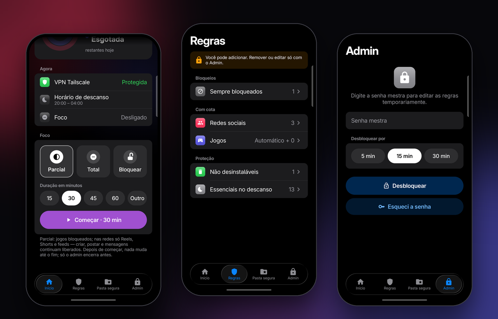
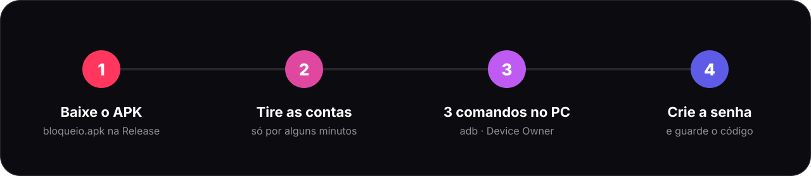

<p align="center">
  
</p>

<p align="center">
  <a href="https://github.com/Heatxfps/bloqueio/releases/latest/download/bloqueio.apk"></a>
  <a href="https://heatxfps.github.io/bloqueio/"></a>
</p>

<p align="center">
  <a href="https://github.com/Heatxfps/bloqueio/releases/latest"></a>
  
  <a href="https://github.com/Heatxfps/bloqueio/actions/workflows/build.yml"></a>
  <a href="LICENSE"></a>
</p>

**Bloqueio** é um app Android de autocontrole digital que não se desliga com dois toques. Ele vira o *dono do aparelho* (Device Owner) e passa a valer de verdade:

- **Cotas diárias** para redes sociais e jogos, em que só Reels e Shorts descontam.
- **Modos de foco** com cronômetro.
- **Horário de descanso** à noite.
- **VPN travada.**
- **Proteção contra desinstalação.**

Para mudar qualquer regra, só com a **senha do admin**.

Sem anúncios, sem contas e sem servidor: tudo fica no seu celular.

<p align="center"></p>

## O que ele faz

<table>
  <tr>
    <td width="50%"></td>
    <td width="50%"></td>
  </tr>
  <tr>
    <td width="50%"></td>
    <td width="50%"></td>
  </tr>
</table>

| | Funcionalidade | Em poucas palavras |
|---|---|---|
| ⏱️ | **[Cotas](docs/funcionalidades/02-cotas.md)** | 20 min de redes e 20 min de jogos por dia (ajustável, e cada uma pode ser desligada). Nas redes, a cota só desce em **Reels e Shorts**. Quando acaba, só eles somem: Direct, feed e publicar continuam. |
| 🎯 | **[Foco](docs/funcionalidades/05-foco.md)** | **Parcial** (sem consumo), **Total** (sem redes e jogos) ou **Bloquear** (só os essenciais). 15 a 60 min ou personalizado. Depois de começar, não dá para trocar. |
| 🌙 | **[Descanso](docs/funcionalidades/03-horario.md)** | No horário escolhido (padrão 20h–4h), o celular vira um Hub com relógio e só os apps essenciais. Notificações e controles rápidos continuam. |
| 🏦 | **[Pasta segura](docs/funcionalidades/04-pasta-segura.md)** | Para os apps de banco: abrem num "ambiente limpo" (sem depuração nem opções do desenvolvedor) e funcionam até no descanso. |
| 🛡️ | **[Proteção](docs/funcionalidades/06-protecao.md)** | Não desinstala, não volta às configurações de fábrica pelas Configurações e não entra em modo seguro. Bloqueie qualquer app, e a regra continua mesmo se ele for reinstalado. |
| 🔐 | **[Admin](docs/funcionalidades/08-admin.md)** | Senha mestra com hash PBKDF2 e código de recuperação. Você só **adiciona** regras; para tirar, só o admin. |
| 🌐 | **[VPN](docs/funcionalidades/01-vpn.md)** *(opcional)* | Trava o Tailscale ligado. Se o seu servidor cair, desliga sozinho para a internet não parar, e religa quando ele volta. |
| 📳 | **[Now Bar](docs/funcionalidades/10-now-bar.md)** | Cronômetro do foco na Now Bar da Samsung (One UI 8+). Fora do foco, a notificação mostra o anel das cotas em min:seg. |

## Instalar

<p align="center"></p>

O guia completo, com o caminho de cada menu e a solução dos erros comuns, está em **[docs/INSTALACAO.md](docs/INSTALACAO.md)**. Leva uns 15 minutos. O resumo:

1. **Baixe** o [`bloqueio.apk`](https://github.com/Heatxfps/bloqueio/releases/latest/download/bloqueio.apk) e instale o [Platform Tools](https://developer.android.com/tools/releases/platform-tools) (adb) no computador.
2. No celular, ative a **depuração USB** e **remova todas as contas** (Google, Samsung…). Elas voltam no fim.
3. Com o celular no cabo, rode no computador:
   ```bash
   adb install bloqueio.apk
   adb shell dpm set-device-owner dev.foco.bloqueio/.admin.BloqueioAdminReceiver
   adb shell pm grant dev.foco.bloqueio android.permission.WRITE_SECURE_SETTINGS
   adb shell appops set dev.foco.bloqueio GET_USAGE_STATS allow
   ```
4. Coloque as contas de volta, abra o **Bloqueio**, crie a **senha do admin** e **guarde o código de recuperação**.

> [!WARNING]
> **Leia antes de instalar.** O Bloqueio foi feito para ser difícil de desligar, e isso vale para você também.
> - Para tirar o app, só com a senha: **Admin → Remover proteção do dispositivo**.
> - Se você perder **a senha e o código de recuperação**, a única saída é a restauração de fábrica pelo modo de recuperação do aparelho, que **apaga tudo**.
> - Alguns apps de banco desconfiam de qualquer app com acessibilidade ligada. Por isso existe a [pasta segura](docs/funcionalidades/04-pasta-segura.md), mas não há garantia de que todo banco aceite.

## Perguntas frequentes

<details>
<summary><b>O app manda meus dados para algum lugar?</b></summary>

Não. Não há servidor, conta nem análise de uso. O que a acessibilidade lê (qual app está aberto e se a tela é de Reels ou Shorts) fica só na memória do celular. O app não usa a internet para nada além de testar se a sua VPN está funcionando.
</details>

<details>
<summary><b>Como a senha do admin é guardada?</b></summary>

A senha nunca é salva. O app guarda só um hash **PBKDF2-SHA256** (120 mil rodadas, com sal aleatório) no armazenamento privado dele, com o backup desligado. Depois de 5 erros, ele trava as tentativas por um tempo que dobra a cada novo erro.
</details>

<details>
<summary><b>Preciso usar Tailscale?</b></summary>

Não. Sem o Tailscale, a função de VPN fica parada e o resto funciona normalmente. Você também pode desligá-la em **Admin → VPN**.
</details>

<details>
<summary><b>Funciona em qualquer Android?</b></summary>

Funciona em Android 10 ou mais novo. A Now Bar é da Samsung (One UI 8+). O app liga sozinho a opção que libera a Now Bar para apps de fora da Samsung (**Notif. ao vivo para todos apps**). Nos outros celulares, o cronômetro do foco aparece como notificação normal. A detecção de Reels e Shorts foi conferida no Instagram, no YouTube e no Facebook em português. Se um app mudar o layout, veja [LIMITACOES.md](docs/LIMITACOES.md).
</details>

<details>
<summary><b>Por que não está na Play Store?</b></summary>

A Play Store não aceita apps que precisam virar Device Owner por adb. Por isso o APK é distribuído aqui, assinado sempre com a mesma chave: as atualizações instalam por cima.
</details>

## Para desenvolvedores

| Documento | Conteúdo |
|---|---|
| [ARQUITETURA.md](docs/ARQUITETURA.md) | Serviços, ordem das decisões de bloqueio, fluxo de dados |
| [DESIGN.md](docs/DESIGN.md) | Design system no estilo Apple: tokens, vidro, movimento, acessibilidade |
| [PADROES.md](docs/PADROES.md) | Padrões de código, assinatura e como contribuir |
| [LIMITACOES.md](docs/LIMITACOES.md) | O que o Android não deixa fazer e o que pode quebrar |

**Compilar:** todo push compila no GitHub Actions (**Actions → Build APK → Artifacts**), e cada tag `v*` publica uma Release. Para compilar localmente (JDK 17 + Android SDK 36):

```bash
gradle :app:assembleDebug
```

**Stack:** Kotlin 2.2, Jetpack Compose (tema próprio no estilo iOS, Liquid Glass com a biblioteca `io.github.kyant0:backdrop`) e kotlinx.serialization. minSdk 29, targetSdk 36.

## Licença

[MIT](LICENSE). A fonte [Inter](https://rsms.me/inter/) vem com a sua própria licença, a [SIL Open Font License](docs/licencas/Inter-OFL.txt).
